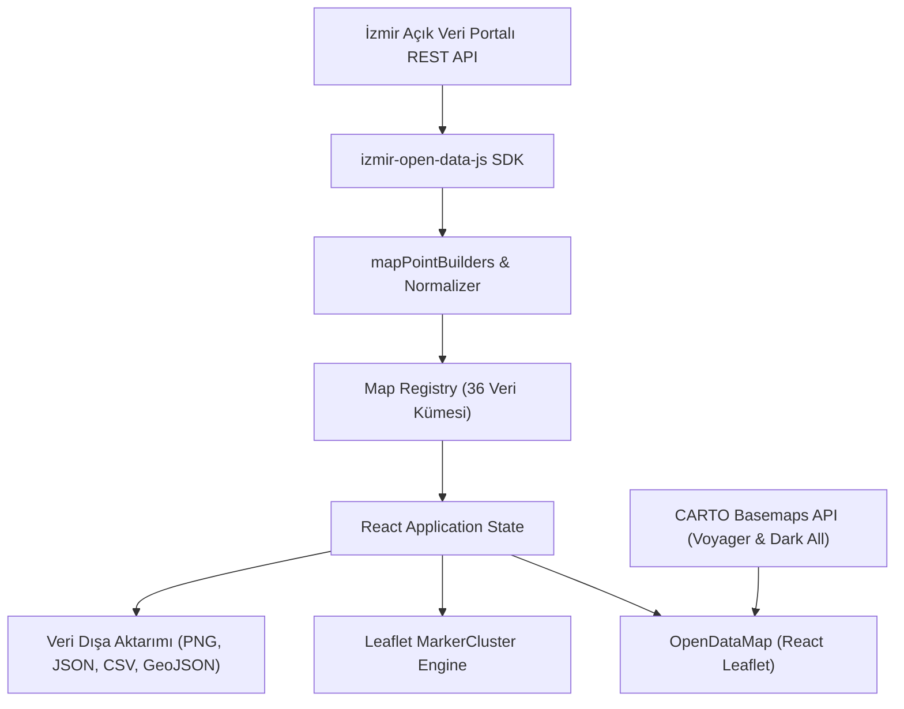
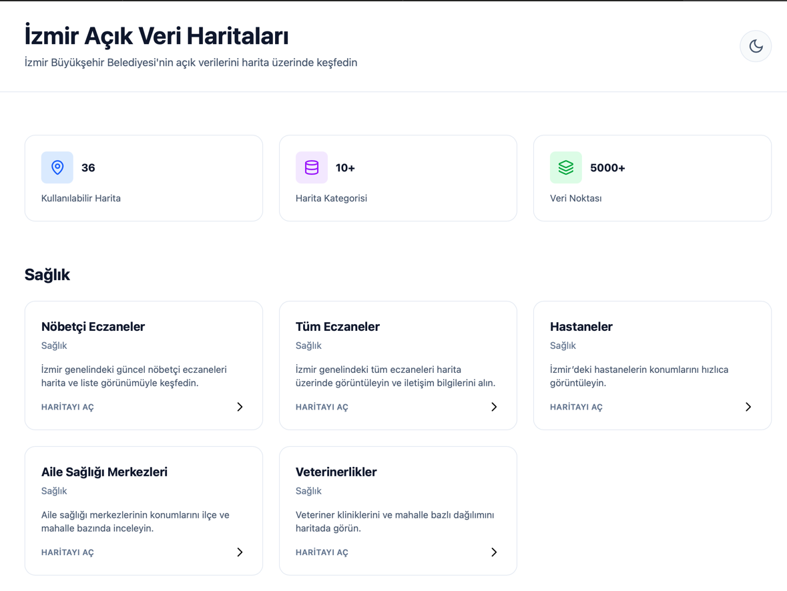

<div align="center">
  
</div>

# İzmir Açık Veri Haritaları

İzmir Büyükşehir Belediyesi Açık Veri Portalı API servislerini kullanarak 36 farklı belediye veri kümesini Leaflet tabanlı etkileşimli haritalar üzerinde görselleştiren web uygulaması.

[](https://github.com/AtaCanYmc/izbb-acikveri-haritalari/actions/workflows/quality.yml)
[](LICENSE.md)
[](https://www.typescriptlang.org/)
[](https://react.dev/)
[](https://web.dev/progressive-web-apps/)

---

## İçindekiler

- [Sistem Mimarisi](#sistem-mimarisi)
- [Ekran Görüntüleri](#ekran-görüntüleri)
- [Harita Kapsamı ve Veri Kümeleri](#harita-kapsamı-ve-veri-kümeleri)
- [Teknik Özellikler](#teknik-özellikler)
- [Teknoloji Yığını](#teknoloji-yığını)
- [Kurulum ve Çalıştırma](#kurulum-ve-çalıştırma)
- [Ortam Değişkenleri](#ortam-değişkenleri)
- [Doğrulama ve Test](#doğrulama-ve-test)
- [CI/CD İş Akışı](#cicd-iş-akışı)
- [Veri Kaynağı ve Lisans](#veri-kaynağı-ve-lisans)
- [Katkıda Bulunma ve Yönetişim](#katkıda-bulunma-ve-yönetişim)

---

## Sistem Mimarisi

Uygulama, belediye açık veri servislerinden çekilen ham veriyi normalize ederek Leaflet işaretçi katmanlarına dönüştürür.



---

## Ekran Görüntüleri

<div align="center">
  
  &nbsp;
  
</div>

---

## Harita Kapsamı ve Veri Kümeleri

Uygulama toplam 36 bağımsız harita katmanını 8 ana kategoride sunar:

| Kategori | Katman Sayısı | Veri Kümeleri |
| --- | --- | --- |
| **Sağlık** | 5 | Nöbetçi Eczaneler, Tüm Eczaneler, Hastaneler, Aile Sağlığı Merkezleri, Veterinerlikler |
| **Ulaşım** | 4 | Otoparklar, Taksi Durakları, Tren Garları, Vapur İskeleleri |
| **Kültür ve Sanat** | 8 | Kütüphaneler, Kültür Merkezleri, Müzeler, Sinemalar, Tiyatrolar, Sergi Salonları, Senfoni Orkestrası, Opera ve Bale |
| **Tarihi Miras** | 7 | Antik Kentler, Antik Yapılar, Köşk ve Konaklar, Kule ve Heykeller, Tarihi Çarşı ve Hanlar, Tarihi Su Yapıları, Tarihi Yapılar |
| **Rekreasyon** | 4 | Plajlar, Hamamlar, Kaplıcalar, Fuar Alanları |
| **Eğitim** | 3 | Üniversiteler, Liseler, Anaokulları |
| **Kamu ve Hizmet** | 3 | Muhtarlıklar, İzBB Hizmet Noktaları, Semt Pazarları |
| **Altyapı ve Acil Durum** | 2 | WiZmirNET Ücretsiz İnternet Noktaları, Afet Toplanma Alanları |

---

## Teknik Özellikler

- **İşaretçi Gruplama:** Yoğun koordinat kümelerinde `leaflet.markercluster` ile istemci taraflı performans optimizasyonu.
- **Dinamik Karo Katmanı:** Açık ve koyu tema geçişine duyarlı CARTO raster karo entegrasyonu.
- **Kullanıcı Konumu:** Tarayıcı Geolocation API üzerinden anlık koordinat tespiti ve yarıçap odaklaması.
- **Arama ve Filtreleme:** İlçe, mahalle ve mekan adına göre istemci tarafında anlık veri filtreleme.
- **Veri Dışa Aktarma:** Seçili harita verilerini PNG ekran görüntüsü, JSON, CSV veya GeoJSON formatlarında indirme.
- **PWA Desteği:** `vite-plugin-pwa` ile çevrimdışı önbellekleme ve mobil cihazlara doğrudan kurulabilirlik.

---

## Teknoloji Yığını

- **Çekirdek:** React 19, TypeScript 5.9, Vite 7
- **Harita Kütüphaneleri:** Leaflet 1.9, React-Leaflet 5, Leaflet MarkerCluster 1.5
- **Stil ve Arayüz:** Tailwind CSS v4, Lucide React
- **Veri Sağlayıcı:** `izmir-open-data-js`
- **Test ve Tip Kontrolü:** Vitest 1.0, ESLint 9, TypeScript `tsc`

---

## Kurulum ve Çalıştırma

### Gereksinimler

- Node.js 18.x veya 20.x
- npm 9 veya üzeri

### Kurulum Adımları

```bash
# 1. Depoyu klonlayın
git clone https://github.com/AtaCanYmc/izbb-acikveri-haritalari.git
cd izbb-acikveri-haritalari

# 2. Bağımlılıkları yükleyin
npm install

# 3. Ortam değişkenlerini yapılandırın
cp .env.example .env

# 4. Geliştirme sunucusunu başlatın
npm run dev
```

Uygulama yerel olarak `http://localhost:5173` adresinde çalışır.

---

## Ortam Değişkenleri

Uygulamanın harita karolarını yükleyebilmesi için bir CARTO Basemaps API anahtarı gerekir.

| Değişken | Tip | Zorunlu | Açıklama |
| --- | --- | --- | --- |
| `VITE_CARTO_API_KEY` | String | Evet | [CARTO Basemaps](https://carto.com/basemaps/apikey) ücretsiz katman API anahtarı |

Örnek `.env` dosyası:

```env
VITE_CARTO_API_KEY=your_carto_api_key_here
```

---

## Doğrulama ve Test

Proje Vitest ile yazılmış birim testleri ve TypeScript tip kontrolleri içerir.

```bash
# Kod stili ve ESLint denetimi
npm run lint

# TypeScript derleyici tip kontrolü
npm run type-check

# Birim testlerini tek seferlik çalıştır
npm test -- --run

# Test kapsam (coverage) raporu üret
npm run test:coverage

# Üretim derlemesi oluştur
npm run build
```

---

## CI/CD İş Akışı

GitHub Actions üzerinde çalışan iki iş akışı mevcuttur:

1. **Code Quality (`.github/workflows/quality.yml`):**
   - Her `push` ve `pull_request` tetiklemesinde çalışır.
   - ESLint, TypeScript `type-check`, Vitest birim testleri ve üretim derleme adımlarını doğrular.

2. **Deploy (`.github/workflows/deploy.yml`):**
   - `main` dalına birleştirilen değişikliklerde derleme çıktısını otomatik olarak GitHub Pages ortamına dağıtır.

3. **Owner Auto-Merge (`.github/workflows/owner-auto-merge.yml`):**
   - Depo sahibine ait çekme isteklerini tüm CI kontrolleri başarıyla tamamlandığında otomatik olarak birleştirir.

---

## Veri Kaynağı ve Lisans

Harita verileri [İzmir Büyükşehir Belediyesi Açık Veri Portalı](https://acikveri.bizizmir.com) üzerinden sağlanmaktadır. Veriler portalın açık veri politikalarına ve CC BY 4.0 lisansına tabidir.

Uygulama kaynak kodları **Apache License 2.0** kapsamında lisanslanmıştır. Detaylı bilgi için [LICENSE.md](LICENSE.md) dosyasını inceleyebilirsiniz.

---

## Katkıda Bulunma ve Yönetişim

- Katkı kuralları, dal adlandırma ve Conventional Commits formatı için [CONTRIBUTING.md](CONTRIBUTING.md) belgesini okuyun.
- Güvenlik açığı bildirim süreci ve yanıt süreleri için [SECURITY.md](SECURITY.md) politikasını inceleyin.
- Gelecek planları ve teknik hedefler için [ROADMAP.md](ROADMAP.md) belgesine göz atın.
